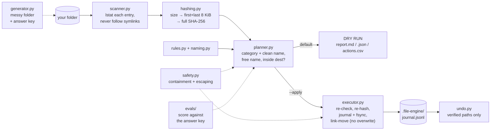

# file-automation-engine

[](https://github.com/paulmadojutimi94/file-automation-engine/actions/workflows/ci.yml)

**Point it at a messy folder and it finds the duplicates, cleans up the names, sorts everything into folders and tells you what it did. It shows you first, never overwrites, never deletes, and can undo.**

> **Status:** v0.1. Python standard library only: nothing to install. 68 tests. Accuracy, safety, latency, cost and attack evals measured; CI re-measures accuracy and attacks on every push.

**Demo (3 min):** [docs/demo/file-engine-demo.mp4](docs/demo/file-engine-demo.mp4), with a narration script in [docs/DEMO.md](docs/DEMO.md).
**Sample output:** [examples/dry-run/report.md](examples/dry-run/report.md) and [examples/demo-terminal.txt](examples/demo-terminal.txt).

## The problem

Your Downloads folder is a kitchen drawer. `IMG_0412 (1).JPG`, `Copy of report FINAL v2.pdf`, the same installer four times, a `.tar.gz` from 2023. Sorting it by hand takes an afternoon, so it never happens.

Scripts that "just sort it" are worse than the mess. Most will **overwrite** `report.pdf` with a different `report.pdf`, follow a shortcut **out of the folder** you pointed them at, call two photos "duplicates" because they're the same size, and give you **no way back**. The goal here: the afternoon of tidying in one command, with the safety of a careful person doing it by hand.

## What it does

1. **Scans** a folder tree with `pathlib`, recording every file and every thing it deliberately skips (hidden files, symlinks, `.git`) with a reason.
2. **Finds duplicates** by content, not name: size, then a SHA-256 of the first and last 8 KiB, then a full SHA-256, so most files are never read.
3. **Renames** to clean, sortable names: `Holiday Photo (1).JPG` → `2025-08-03_holiday-photo.jpg` (optional; template is yours).
4. **Organises** into category folders (`Images/`, `Documents/`, `Archives/`, …; your own rules via JSON). Duplicate copies go to `_duplicates/`, never deleted.
5. **Reports** in Markdown, JSON and CSV: what it found, what it will do, what it couldn't.
6. **Dry run by default** (the bonus). Nothing changes without `--apply`. Every applied run writes an undo journal.

```text
$ make demo
Wrote 1,014 files (119.1 MB) with 163 planted duplicate groups to demo/messy
Planned in 0.11s: 834 moves (834 renamed), 180 duplicates to quarantine, 0 already in place, 4 skipped.
  quarantine Desktop/Copy of untitled.JPG  ->  _duplicates/Desktop/Copy of untitled.JPG
  ...
DRY RUN: nothing was changed. Review demo/reports/report.md, then re-run with --apply.

Applied: 1,014 moved, 0 skipped, 0 failed.
Undo:   file-engine undo demo/messy/.file-engine/journal-20261111-233339-380121.jsonl --apply

Planned in 0.02s: 0 moves (0 renamed), 0 duplicates to quarantine, 834 already in place, 4 skipped.   <- second run: nothing to do
restored: 1014
Removed 29 empty folder(s) the run had created.
```

All 180 copies the generator planted were found, while reading 41.8 MB of the folder's 119.1 MB. The very first version of this code, on a folder like this, quarantined only 93 of 180 copies and had work left over on its second run. How that was found and fixed is in the [postmortem](docs/POSTMORTEM.md).

## Architecture



Think of a removal company. The **scanner** walks every room and lists every item, but won't go through a door that leads to the neighbour's house (symlinks). The **duplicate finder** spots the three identical kettles: first by size, then by a glance at both ends, and only then by a full inspection. The **planner** writes the inventory sheet: which box each item goes in and what the label says, making sure no two boxes get the same label. You read the sheet (**dry run**). Only when you sign it does the **executor** move anything, ticking each line in the logbook *before* lifting the item, and never putting a box where one already stands. The logbook is how **undo** puts everything back.

**Plan, then act.** The planner only reads; the executor only runs a finished plan. The dry run *is* the plan, so it can't disagree with the real run. ([Design doc](docs/DESIGN.md) has the alternatives that lost.)

**Moves can't overwrite.** `os.rename()` silently replaces an existing file. The executor uses `os.link()` (atomic, and fails if the name is taken) then removes the old name; across disks it copies into a file opened with `"x"` (create-or-fail).

**File names are untrusted input.** Anyone who sends you a zip file chooses its file names. Nine defences stop them escaping the folder, overwriting your files, hiding your data in quarantine, or rewriting your terminal and spreadsheet, and the attack eval switches each one off to prove it's doing real work.

## Try it in one minute

```bash
git clone https://github.com/paulmadojutimi94/file-automation-engine && cd file-automation-engine
make demo                                     # generate a messy folder, dry run, apply, re-run, undo

# on your own folder: dry run first, always
PYTHONPATH=src python3 -m file_engine scan ~/Downloads                 # inventory + duplicates, read-only
PYTHONPATH=src python3 -m file_engine organize ~/Downloads --rename    # see the plan
PYTHONPATH=src python3 -m file_engine organize ~/Downloads --rename --apply
PYTHONPATH=src python3 -m file_engine undo ~/Downloads/.file-engine/journal-<time>.jsonl --apply
```

Useful flags: `--dest ~/Sorted` (organise elsewhere), `--template "{category}_{name}"`, `--rules my-rules.json` (`{"Receipts": [".pdf"], ...}`), `--no-dedupe`, `--include-hidden`. Needs Python 3.12+. `pip install -e .` gives you a `file-engine` command.

## Eval results

All reproducible with `make eval`, which rewrites this table from `evals/results/`. CI re-measures accuracy, the gold set and attacks on every push and fails if this table drifts from the result.

<!-- results:start -->
| What | Result | How it was measured |
|---|---|---|
| **Duplicates found** (pair precision / recall) | **100.0% / 100.0%** | 20 held-out trees (seeds 100-119), 40,280 files, 4.83 GB |
| Duplicate groups exactly right | 6432/6432 | Every member, no extras |
| Near-duplicate traps wrongly grouped | **0** / 800 | Same size, same first+last 8 KiB, or same start with a different last byte |
| Empty files flagged as duplicates | 0 | Deliberately excluded |
| **Categorisation**: generated files | 100.0% | Generator's own ext → folder table |
| **Categorisation**: hand-labelled gold set | **40 / 40** (first run 32/40) | 40 names written and frozen before running; see postmortem |
| **Dry run** left every byte, timestamp and folder untouched | **20/20** trees | Full manifest incl. mtimes, before vs after |
| **Data loss** after apply | **0** (bytes identical in 20/20 trees) | Sorted SHA-256 of every file, before vs after |
| Each duplicate group left with exactly one live copy | 6432/6432 | Copies in `_duplicates/`, never deleted |
| Moves completed | 40,280 / 40,280 | None skipped or failed |
| **Idempotent** (2nd run plans 0 actions) | 20/20 | Same flags, same tree |
| **Undo** restores every path, byte and file mtime | 20/20 | Folder mtimes excepted (known failure) |
| **Latency**: dry run (scan + dedupe + plan) | **p50 482 ms, p95 561 ms** | 5,014 files, 612 MB, 20 warm runs |
| Latency: duplicate finding only (3 sieves) | p50 203 ms, p95 224 ms | Same tree, same files |
| Latency: same tree, naive SHA-256 of every file | p50 583 ms, p95 701 ms | Hashing only, no planning |
| **Bytes read** to find duplicates | **210 MB** vs 612 MB naive (66% less) | 2,126 edge-hashed, 749 fully hashed |
| Latency: apply (move + journal + fsync) | p50 1,658 ms, p95 2,321 ms | 5,014 moves; ~70% is fsync (design doc) |
| Latency: undo | p50 438 ms, p95 492 ms | Same moves reversed |
| Latency: whole CLI, cold start, dry run | p50 683 ms, p95 782 ms | Includes Python start-up and writing 3 reports |
| Peak memory (Python heap) | 10.9 MB | 5,014 files; grows with file count, not size |
| **Cost per task** | **€0.00** | 0 paid API calls; runs locally |
| **Attack success rate**, all defences on | **0 / 16 (0.0%)** | 16 attacks, each in its own temp folder |

| Defence switched off | Attacks that then get through |
|---|---|
| Path containment (one path segment, resolve() inside dest) | 3 / 3 |
| lstat(): never follow symlinks while scanning | 1 / 2 |
| lstat() AND stale-plan check together | 0 / 1 |
| Re-hash copy and keeper before quarantine | 1 / 1 |
| Stale-plan check (still a regular file, same size and mtime) | 1 / 1 |
| No-clobber move (os.link, then unlink) | 1 / 1 |
| Case- and accent-insensitive name claims | 0 / 1 |
| Name claims AND no-clobber move together | 1 / 1 |
| 255-byte name limit | 1 / 1 |
| Escaping in terminal, Markdown and CSV output | 4 / 4 |
| Undo journal path checks | 2 / 2 |

Measured on Linux x86_64, 2 CPUs, Python 3.13.18.
<!-- results:end -->

How to read it:

- **Two independent accuracy checks.** The generator and the rules were written by the same person, so 100% on generated files is weaker than it looks: they share blind spots. The **gold set** is 40 file names labelled by hand and frozen *before* the first run. That run scored **32/40** (`.markdown`, `.htm`, `.toml`, `Makefile`, …), which is exactly why it exists. It now scores 40/40, but it has been seen, so treat that as a regression test; a fresh gold set is next step 1.
- **Pair precision and recall:** take every pair of files and ask "did we call these duplicates exactly when they really are?" Precision 100% means no false duplicates (the dangerous error: a unique file quarantined). Recall 100% means none missed.
- **Traps** are files built to fool lazy dedupe: same size but different bytes, identical first and last 8 KiB with one changed byte in the middle, or one changed final byte.
- **Held-out seeds.** Nothing was tuned on seeds 100-119; they're the exam, not the practice papers.
- **p50 and p95:** half the runs were faster than p50, 95 in 100 faster than p95. Files were in the OS cache (warm). Like for like, duplicate finding with the 3 sieves takes 203 ms against 583 ms for hashing every file (~2.9× faster) even with files cached; on a cold disk, USB stick or network drive, where reading *is* the cost, the 66% fewer bytes matters more. Most of the dry run's time is per-file planning work, not hashing.
- **Apply latency is mostly fsync** (~2.0 s with it, ~0.6 s without, for 5,000 moves): the price of an undo journal that survives a power cut.
- **The ablation table is the point.** 0% attack success with everything on could just mean weak attacks. The second table shows each attack getting through once its defence is removed. Three rows show **0** on purpose: a deeper layer still holds. With `lstat()` off, the stale-plan check (which also uses `lstat`) still catches a symlinked file, and with both off, the move itself links the symlink rather than its target (`follow_symlinks=False`). With name claims off, the no-clobber move still refuses to overwrite; switch both off and the attack lands.

## Known failures

- **Folder timestamps aren't restored by undo.** Every file's path, bytes and modified time are; a folder's mtime changes whenever files enter or leave it.
- **Categories come from extensions only.** A PDF renamed `.txt` goes to Documents as text; an extensionless file goes to `Other` unless it's a well-known name like `Makefile`.
- **The gold set has been seen.** 40/40 now is a regression test; first-run accuracy on unseen names was 32/40 (80%).
- **Duplicates are exact bytes only.** The same photo re-saved, resized or with different metadata is not a duplicate. (That needs perceptual hashing; out of scope.)
- **The keeper rule is a heuristic.** "Doesn't look like a copy, then oldest, then shortest path" is usually right, not always. Everything goes to `_duplicates/` with its original path so you can swap back.
- **Collisions are numbered conservatively.** A name that's free only because its current owner is about to move away still gets `-2`.
- **No hash cache.** Every run re-reads candidate files. Fine for thousands of files; slow for a 2 TB photo library.
- **Hard links are a move mechanism, not a feature.** If the process dies between `link` and `unlink`, a file can be left with two names (never zero); undo reports it rather than guessing.
- **A tampered journal header could widen what undo accepts.** Undo trusts the journal's *location* for the destination folder and checks every line against the header's root, but the header itself isn't signed. Undo is a dry run by default so you see the paths first.
- **Tested on Linux.** Collision checks treat names as case- and accent-insensitive everywhere (safe for macOS/Windows), but the evals ran on ext4 only. Windows is untested.

## Postmortem

**[Full write-up in docs/POSTMORTEM.md](docs/POSTMORTEM.md).** The headline incident:

- **What happened.** The first full `--apply` on 1,014 files said `927 moved, 87 skipped`. All 87 were duplicate copies: 48% of the duplicates silently stayed put.
- **How it was found.** Every skip read *"cannot re-read <keeper>"*, and a second dry run straight after still wanted to quarantine the same 87. A tidy-up that has work left on its second run is broken.
- **Root cause.** Actions ran in path order. A keeper often sorts before its copy, so it was moved first; then the copy's safety check re-hashed the keeper at its old path, found nothing, and correctly refused. Right check, wrong order.
- **Fix and guard.** All quarantines now run before any keeper moves. Copies handled 93/180 → 180/180; second-run actions 87 → 0. The eval now checks every duplicate group ends with exactly one live copy (6,432/6,432) and that every tree is idempotent (20/20).

It also covers the eval's judge being wrong twice (and why I fixed the judge, not the engine), the gold set exposing shared blind spots (32/40), two attacks that were blocked by accident, and invisible right-to-left characters in our own source.

## Next steps

1. **A fresh gold set of real file names** from a real Downloads folder, labelled before running, to replace the one that's now been seen.
2. **Hash cache** keyed on `(path, size, mtime)` in SQLite, so re-runs only hash new or changed files.
3. **Group-commit the journal** (fsync every 100 moves or 50 ms): apply ~3× faster, with the crash window documented.
4. **Restore folder timestamps on undo** by journaling folder mtimes before the run.
5. **Watch mode** for `~/Downloads` (organise new files as they arrive, with a quiet period so half-downloaded files are left alone).
6. **Claude-assisted rules, only if extension rules prove too blunt in real use.** E.g. "is this PDF a receipt, a contract or a manual?" It would get its own eval: accuracy against labelled files, cost per file, p95, and prompt-injection success rate, because file names and contents are attacker-controlled.

## Repo map

| Path | What's there |
|---|---|
| `src/file_engine/` | The tool: 13 small modules, one job each ([CLAUDE.md](CLAUDE.md) has the map) |
| `tests/` | 68 tests: scanning, hashing, rules, naming, plan/apply/undo, CLI end to end |
| `evals/` | Accuracy, gold set, performance and attack evals, and `run_all.py`, which writes the tables above |
| `evals/results/` | The numbers those evals produced |
| `examples/` | A dry-run report (Markdown, JSON, CSV) and the `make demo` terminal transcript |
| `docs/DESIGN.md` | One-page design doc: decisions and the alternatives rejected |
| `docs/POSTMORTEM.md` | What went wrong and how it was found |
| `docs/CHEATSHEET.md` | Every line of the code explained, plus an interview drill |
| `docs/LEARN.md` | pathlib, hashing and safe automation, taught through this code, with exercises |
| `docs/DEMO.md`, `docs/demo/` | The 3-minute video, its timed narration script, and `make_video.py`, which rebuilds it from real outputs |
| `scripts/check_invisible_chars.py` | Guard against invisible and right-to-left characters in code and docs |
| `.github/workflows/ci.yml` | On every push: lint, invisible-character check, tests, re-measured evals, README check, demo run |
| `CLAUDE.md` | The guide for AI agents working in this repo |

MIT-licensed.
